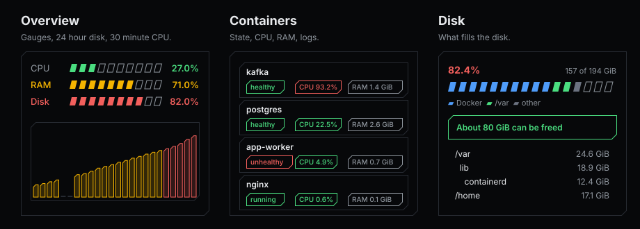

Megazinee is an [Orca](https://github.com/stablyai/orca) plugin that shows CPU, RAM, disk and Docker containers for
Linux servers you can reach over SSH. It keeps one SSH connection open per server and reads `/proc` every two
seconds. Nothing is installed on the servers.

```sh
orca plugin install AnhTuan2111/orca-megazinee
```

## In the panel

Each server gets a row with its CPU, RAM and disk. Click a row to open that server below the list.



- **Overview**: CPU, RAM and disk now, disk over the last 24 hours, CPU over the last 30 minutes, load and network.
- **Containers**: state, CPU and RAM of every container. Select one to read its logs in the panel (search, filter by
  level, follow) or to open a shell in it.
- **Disk**: what takes up the disk, how much Docker could give back, and the largest directories.

The status bar shows whichever server is in the worst state. Orca also sends a desktop notification when a server
stops answering, when disk or RAM goes past 80%, when CPU stays above 80% for a minute, or when a container turns
unhealthy.

## Colours

Green under 50%, blue from 50%, yellow from 70%, red from 80%.


## Adding servers

Click the gear at the top of the panel, write one server per line, then Save. Add `:port` if SSH is not on port 22.

```text
web-01=ubuntu@10.0.0.1
monitor=admin@10.0.0.2:2222
```

The servers have to accept your SSH key; the plugin never asks for a password. On Windows it runs the `ssh.exe` that
comes with Git for Windows, because the OpenSSH bundled with Windows exits with code 255 inside Orca's worker.

## Working on it

```sh
orca plugin dev watch .     # load the folder into Orca, reload on save
orca plugin test .          # run the tests
python docs/make_svgs.py    # redraw the images in this README
```

The cut corners come from [augmented-ui](https://github.com/propjockey/augmented-ui) (BSD-2-Clause), kept in
`vendor/augmented-ui`.
