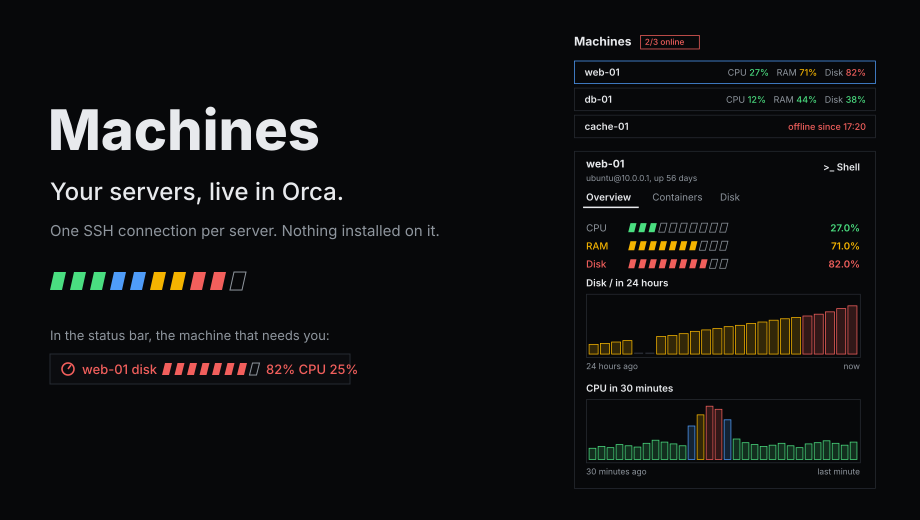

```sh
orca plugin install AnhTuan2111/orca-megazinee
```

## Three tabs per machine


Notifications when a machine goes offline, disk or RAM passes 80%, CPU stays above 80%, or a container fails.

## Four colours


## Add a machine

Press the gear on the panel, add a line, press Save. Key login only.

```text
web-01=ubuntu@10.0.0.1
monitor=admin@10.0.0.2:2222
```

On Windows the plugin uses Git for Windows' `ssh.exe`.

## Develop

```sh
orca plugin dev watch .     # load, reload on save
orca plugin test .          # tests
python docs/make_svgs.py    # redraw these images
```
