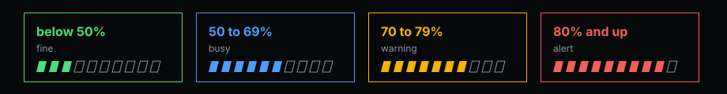

<h1 align="center">Machines</h1>

<p align="center">
  Live health of your Linux servers, right in <a href="https://github.com/stablyai/orca">Orca</a>'s sidebar.<br>
  One SSH connection per server. Nothing to install on it.
</p>

<p align="center">
  
</p>

## What you see

| Part | What it shows |
|---|---|
| **Host list** | One row per machine with CPU, RAM and disk. Press a row to open it below. |
| **Overview** | Block gauges, disk `/` over 24 hours, CPU over 30 minutes, load, network, containers. |
| **Containers** | Every container with an icon for its kind, its state, CPU and RAM. Logs and Shell open in Orca. |
| **Disk** | Disk map, Docker space you can free, directory tree, largest container logs. |
| **Status bar** | The machine in the worst shape, coloured by its worst number. |
| **Notifications** | Offline for 30 s, disk or RAM from 80%, CPU at 80% for a minute, a failing container. |

<p align="center">
  
</p>

## Colours

Four colours, from calm to urgent. A gauge, its number and its label share the colour, so a row turns yellow or red
as a whole.

<p align="center">
  
</p>

Gauges fill cell by cell like a magazine being loaded: `▰` loaded, `▱` empty, 10% per cell. Chips and frames are
square outlines on black, and container chips sit in fixed columns so they line up like a table.

<p align="center">
  
</p>

## Install

```sh
orca plugin install AnhTuan2111/orca-machines
```

Orca asks you to approve a Node worker, the plugin's own settings and storage, notifications, reading workspace
names and opening terminals.

## Add machines

Press the gear on the panel, write one machine per line, press Save:

```text
web-01=ubuntu@10.0.0.1
db-01=deploy@db.example.com
```

The target is what you would type after `ssh`, or a `Host` from `~/.ssh/config`. Key login only: the plugin runs
`ssh` with `BatchMode=yes`.

## Good to know

- A short `sh` loop reads `/proc` every 2 seconds over the open connection and exits when the connection closes.
  Docker and systemd are read every 15 seconds; `docker stats` and `du` run only when you open their tab.
- History lives in the plugin's storage, so charts survive an Orca restart. Nothing is measured while Orca is closed.
- Notifications run only while Orca is open. They do not replace Prometheus and Alertmanager.
- Windows: the worker uses Git for Windows' `ssh.exe`, because the OpenSSH one that ships with Windows exits with
  code 255 inside Orca's worker. Point the ssh path setting elsewhere if needed.
- Shell and Logs go through the `orca` CLI (`orca terminal create --focus`), because the plugin API's
  `terminal.create` opens no tab.

## Develop

No build step: Orca loads the `.ts` and `.tsx` files in `src/` directly.

```sh
orca plugin dev watch .     # load and reload on save
orca plugin test .          # tests in src/*.test.ts
orca plugin check .         # render every scenario in src/panel.check.ts
npx -p typescript tsc -p .  # type check
python docs/make_svgs.py    # redraw the README images
```

On Windows with Orca 1.4.258, `test` and `check` fail when the plugin sits on another drive than Orca
(`cannot import "./orca-runtime.mjs"`); run them from a copy on `C:`.
