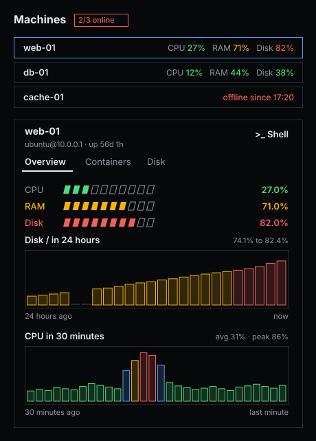
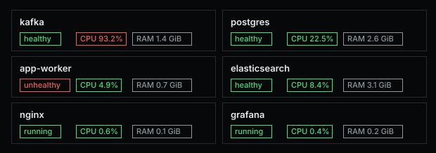

<h1 align="center">Machines</h1>

<p align="center">
  Live health of your Linux servers, right in <a href="https://github.com/stablyai/orca">Orca</a>'s sidebar.<br>
  One SSH connection per server. Nothing to install on it.
</p>

<p align="center">
  
</p>

## What you see

| Part | What it shows |
|---|---|
| **Host list** | One row per machine with CPU, RAM and disk. Press a row to open it below. |
| **Overview** | Block gauges, disk `/` over 24 hours, CPU over 30 minutes, load, network, containers. |
| **Containers** | Every container with an icon for its kind, its state, CPU and RAM. Logs and Shell open in Orca. |
| **Disk** | Disk map, Docker space you can free, directory tree, largest container logs. |
| **Status bar** | The machine in the worst shape, coloured by its worst number. |
| **Notifications** | Offline for 30 s, disk or RAM from 80%, CPU at 80% for a minute, a failing container. |

<p align="center">
  
</p>

## Colours

Four colours, from calm to urgent. A gauge, its number and its label share the colour, so a row turns yellow or red
as a whole.

<p align="center">
  
</p>

Gauges fill cell by cell like a magazine being loaded: `▰` loaded, `▱` empty, 10% per cell. Chips and frames are
square outlines on black, and container chips sit in fixed columns so they line up like a table.

<p align="center">
  
</p>

## Install

```sh
orca plugin install AnhTuan2111/orca-machines
```


## Add machines

Press the gear on the panel, write one machine per line, press Save:

```text
web-01=ubuntu@10.0.0.1
db-01=deploy@db.example.com
```

The target is what you would type after `ssh`. Key login only.

## Good to know

- Nothing runs on the server after you close Orca: the `sh` loop that reads `/proc` lives on the SSH connection.
- Windows: the worker uses Git for Windows' `ssh.exe`; the OpenSSH that ships with Windows exits with 255 in Orca.

## Develop

```sh
orca plugin dev watch .     # load and reload on save
orca plugin test .          # tests (from a copy on C: if Orca sits on another drive)
python docs/make_svgs.py    # redraw the README images
```
